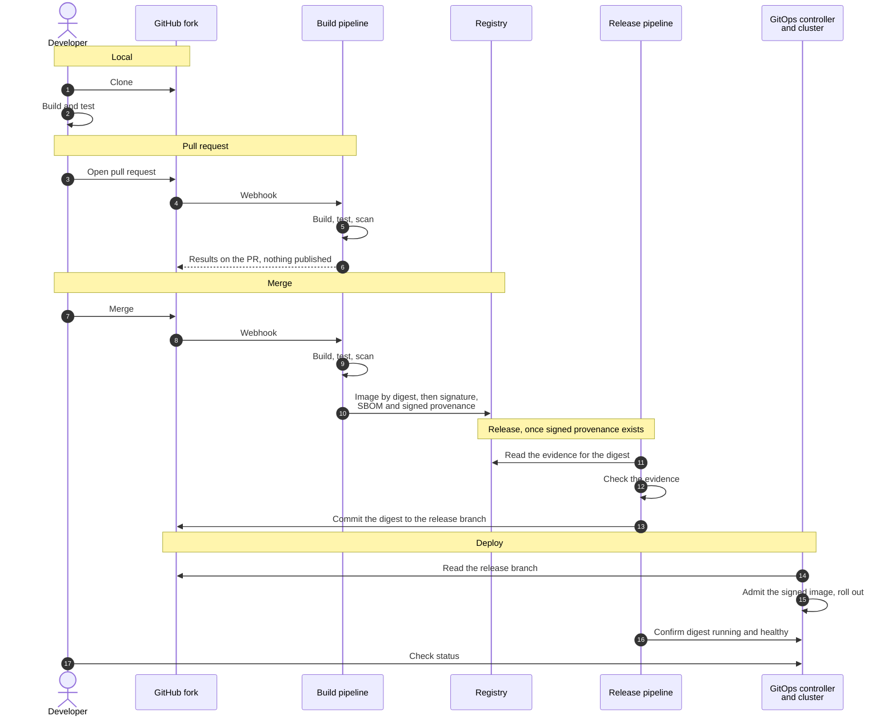
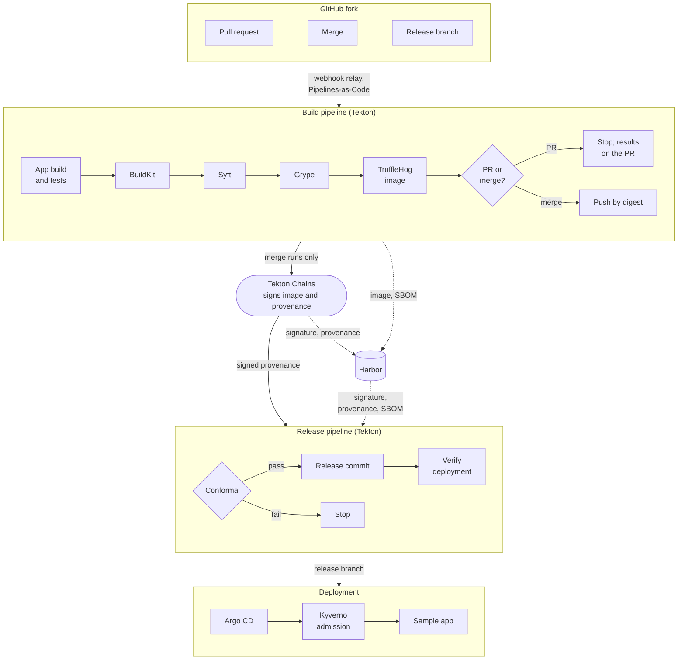

# Design: Executable Golden Path MVP for Kubernetes

This is the design for a small, runnable golden path: a developer merges a change, and the
platform builds it, checks it, releases it and deploys it to a local Kubernetes cluster. It
is the design step of
[issue #8](https://github.com/cdfoundation/Platform-Engineering/issues/8), written for
review before any code exists. Sections marked **Proposed** are open for discussion; the
open questions are collected at the end.

The example makes one slice of the
[open source SSDF reference architecture](../reference-architectures/open-source-ssdf-cicd.md)
executable, with the same tools, so the page and the example stay in step. Every step is
defined by what it reads and writes, so each tool can be replaced on its own.

## Goals

- A contributor can run the whole path on a laptop, from a clean machine, with documented
  commands, and remove it again.
- A developer's part ends at the merge. Everything after it is the platform's.
- The deployed workload is one image digest that was built, scanned, signed and approved,
  and each of those facts can be checked.
- No cloud account or paid service is needed.

Not in the MVP, as in the issue: multi-cloud, high availability, observability stacks,
multi-tenancy, enterprise identity, full policy enforcement, developer portals, and
infrastructure provisioning beyond the local cluster.

## Developer workflow

| Stage | What happens | Stops when |
| --- | --- | --- |
| Local | The developer clones the repository and builds and tests the application with its own commands. | — |
| Pull request | CI builds and tests the change, builds the image, scans it for vulnerabilities and secrets, and reports on the PR. Nothing is pushed or deployed. | A build, test or scan fails |
| Merge | CI builds and scans the image, pushes it by digest, and each scan result is recorded against that digest in signed build provenance. | A build, test or scan fails |
| Release | A platform pipeline checks the signed evidence for that exact digest and, if it passes, commits the digest to the branch the GitOps controller reads. | Evidence is missing, invalid, for another digest, or records a failed check |
| Deploy | The GitOps controller rolls the digest out. The cluster admits only images the pipeline signed. A last step confirms the running pods use that digest and are healthy. | Image unsigned or referenced by tag, sync fails, or app unhealthy |

### Developer and platform responsibilities

| | Developer | Platform |
| --- | --- | --- |
| Application source, Dockerfile, Kustomize manifests | Owns | Checks them in CI |
| Pipeline definitions | Supplies parameters, such as build and test commands | Owns; the app repo references them by digest |
| Release policy and admission policy | Reads the result | Owns |
| Image digest in the release branch | Never edits it | The release pipeline is the only writer |
| Signing key, release credential | No access | Held in platform namespaces |
| Deployment status | Reads it | The GitOps controller reports it |

## Architecture

Everything runs in one kind cluster on the laptop except the developer's GitHub fork and a
webhook relay that forwards GitHub's events into the cluster.

The release pipeline writes its commit to the release branch on GitHub, and Argo CD reads
that branch with read-only access. Nothing else deploys to the application's namespace.

## Component choices

**Proposed.** The middle column is the issue's starting list. Where the proposal differs,
the reason is in the row.

| Capability | In the issue | Proposed for the MVP | Why | Swap |
| --- | --- | --- | --- | --- |
| Sample application | Minimal containerized HTTP service | The same, in Go | See the decision below | Any service with a Dockerfile |
| Local Kubernetes | kind | kind | Recreated with one command; teardown is deleting the cluster | minikube, k3d |
| Git host | — | The developer's GitHub fork | The one piece most developers already have; no Git server to run | An in-cluster Git server removes the relay |
| Trigger | — | Pipelines-as-Code with a webhook relay (gosmee) | Starts a run for the exact commit and reports on the PR; the relay is how its docs reach a local cluster | A self-hosted Actions runner connects outward and needs no relay |
| CI | GitHub Actions | Tekton | GitHub-hosted runners can't reach a registry inside kind. Running CI in the cluster keeps the path local and matches the reference architecture | GitHub Actions on a self-hosted runner in the cluster |
| Image build | BuildKit | BuildKit | Builds an ordinary Dockerfile unchanged | Buildah |
| SBOM | — | Syft | Gives the scan and later slices one inventory of the image | Trivy |
| Vulnerability scan | Trivy | Grype | Same role; Grype is the reference architecture's pick and Trivy its listed alternative | Trivy |
| Image secret scan | — | TruffleHog | A secret can arrive in a dependency or base layer without being in the repository | Trivy |
| Registry | OCI-compatible registry | Harbor | Keeps the image, signature, provenance and SBOM together by digest | Any OCI registry that stores attached artifacts |
| Signing and provenance | Optionally Cosign | Tekton Chains | Signs outside the build steps, so a build can't sign its own result | Cosign from a platform-owned job |
| Release gate | — | Conforma, with a minimal policy | One decision on signed evidence before anything deploys | Cosign policy mode; Conftest |
| GitOps | Flux or Argo CD | Argo CD | See the decision below | Flux CD |
| Packaging | Kustomize | Kustomize | The release commit sets the image digest in the overlay | Helm |
| Admission | — | Kyverno | The cluster refuses anything that didn't come through the pipeline | Sigstore Policy Controller |
| Diagrams | Mermaid | Mermaid | — | — |

## Decisions

### CI runs inside the cluster

A registry in kind has no address a GitHub-hosted runner can reach, so CI has to run where
the registry is. Tekton does, and it is what the reference architecture already maps to
SSDF tasks. Tekton is also a CD Foundation project, and the SIG's charter is about showing
how platform teams build on those. Its signing component, Chains, runs outside the build
steps, so a build can't sign its own result.

GitHub Actions stays possible with a self-hosted runner in the cluster. The runner connects
outward, so it needs no webhook relay, which is simpler. It would have to write the same
evidence with Cosign from a job the application can't change, as the reference architecture
describes for other CI systems.

### The platform writes the digest

Step 4 of the issue's workflow, updating the desired state in Git, moves to the platform.
The developer merges; the release pipeline commits the approved digest to the release
branch. The developer never copies a digest by hand, and a digest can't reach the cluster
without passing the release check.

### One small release check, not full policy enforcement

The release gate asks four things of the digest: the signature and provenance verify against
the pipeline's key, the provenance names the platform's pipeline definition, the
vulnerability scan and the image secret scan both passed for this digest, and its SBOM
exists. Admission asks three: the image is signed by the pipeline, it is referenced by
digest, and in the application's namespace only the GitOps controller's service account may
create or change workloads. That is enough to show how evidence, release approval
and deployment enforcement relate, and it leaves broader policy for later.

### The built image is scanned for secrets

A scan of the repository misses a secret that reaches the image another way: a key shipped
in a dependency or a base layer, a token left in the image configuration by a build
argument, or a file added in one layer and deleted in a later one. TruffleHog scans the
image layer by layer, with no credential verification, and any finding fails the run.

On pull requests the image is never pushed, so BuildKit writes it as a Docker-format archive
and TruffleHog reads that file. On merges it scans the pushed digest in the registry, so the
result names the digest the release gate checks. The Cybersecurity SIG lists TruffleHog
under this task for scanning repositories; here the same tool reads the build's output. The
reference architecture doesn't have this step yet and would gain the same row.

### One GitOps controller: Argo CD

**Proposed; the issue discussion also makes a case for Flux CD.** Both are listed by the
Cybersecurity SIG and both meet what this path needs from the controller:

- It reads one branch, with read-only access.
- It applies what is there and reverts drift without anyone asking.
- It reports sync and health in a form the pipeline and the developer can read.

Argo CD is proposed because the reference architecture already uses it, so the example and
the page describe the same thing, and because it is the most widely used GitOps controller,
so more readers can map the example onto what they run. It is installed small: no SSO, no notifications, no ingress. Its API
server stays. It is one more small deployment, the pipeline's sync-and-wait task and the CLI
use it, and a developer can open the UI through a port-forward to see what was deployed and
why. The pipeline's token can sync and read the one application and nothing else. Applications are defined in Git with automated sync, pruning and self-heal, so a change
made any other way is reverted.

Flux has no API server or UI of its own; a pipeline using it waits on the status of its
objects in the cluster instead. Both run a few controllers, so neither is notably heavier
for one application on a laptop.

Swapping in Flux changes four things and nothing else: the bootstrap install, the object
that points at the release branch, how the verify step waits for the rollout, and the
service account named in the admission policy. The example should keep those four in one
place.

### The sample application is a small Go service

**Proposed.** The standard library is enough for an HTTP service with a health endpoint, the
result is one static binary on a minimal base image, and the build is fast. A small image
also has few packages for the vulnerability scan to flag, which matters for an example that
has to pass from a clean machine months after it was written. Go is also what most of the
tools in this path are written in, so contributors here are likely to read it.

### A script only for what GitOps can't install

One command creates the kind cluster and installs the GitOps controller. The controller
installs everything else from pinned versions in Git. Teardown is deleting the cluster.

## SSDF mapping

Identifiers are the Cybersecurity SIG's, as used in the reference architecture. A dash means
the SIG lists no task for that step.

| Step | Tool | SIG task |
| --- | --- | --- |
| Review before merge, protected branches | Git host | [1.2 PS.1.1](https://cybersecurity.cd.foundation/docs/ssdf/phase-1/ssdf-ps/), [1.1 PO.5.1](https://cybersecurity.cd.foundation/docs/ssdf/phase-1/ssdf-po/) |
| Start a run from the platform's pipeline definition | Pipelines-as-Code | [1.1 PO.3.1–PO.3.3](https://cybersecurity.cd.foundation/docs/ssdf/phase-1/ssdf-po/) |
| Build and unit tests | The app's own commands | — |
| Image build | BuildKit | [2.3 PW.6.1–PW.6.2](https://cybersecurity.cd.foundation/docs/ssdf/phase-2/ssdf-pw/) |
| SBOM | Syft | [2.3 PW.6.1–PW.6.2](https://cybersecurity.cd.foundation/docs/ssdf/phase-2/ssdf-pw/) |
| Vulnerability scan | Grype | [2.1 PO.4.1–PO.4.2](https://cybersecurity.cd.foundation/docs/ssdf/phase-2/ssdf-po/) |
| Image secret scan | TruffleHog | [2.3 PW.4.1–PW.4.4](https://cybersecurity.cd.foundation/docs/ssdf/phase-2/ssdf-pw/) |
| Store image and evidence by digest | Harbor | [2.2 PS.3.1–PS.3.2](https://cybersecurity.cd.foundation/docs/ssdf/phase-2/ssdf-ps/) |
| Sign image and provenance | Tekton Chains | [2.2 PS.1.1](https://cybersecurity.cd.foundation/docs/ssdf/phase-2/ssdf-ps/) |
| Release decision | Conforma | [2.1 PO.1.1–PO.1.2](https://cybersecurity.cd.foundation/docs/ssdf/phase-2/ssdf-po/) |
| Release commit | git-cli (Tekton catalog) | — |
| Deploy from Git | Argo CD | [2.1 PO.2.1–PO.2.3](https://cybersecurity.cd.foundation/docs/ssdf/phase-2/ssdf-po/), [2.1 PO.5.1–PO.5.2](https://cybersecurity.cd.foundation/docs/ssdf/phase-2/ssdf-po/) |
| Admit only pipeline-built images | Kyverno | [2.1 PO.5.1–PO.5.2](https://cybersecurity.cd.foundation/docs/ssdf/phase-2/ssdf-po/), [2.2 PS.3.1–PS.3.2](https://cybersecurity.cd.foundation/docs/ssdf/phase-2/ssdf-ps/) |
| Confirm the digest is running | Verify step | — |

## Acceptance criteria

The issue's criteria, with where this design meets each. The last row is the addition
suggested in the discussion.

| Criterion | Met by |
| --- | --- |
| Runs from documented prerequisites and commands | One bootstrap command; prerequisites below |
| CI builds and tests the sample application | Build pipeline, on pull requests and merges |
| CI publishes an OCI image to a configured registry | Merge runs push to Harbor by digest |
| The deployment references an immutable image digest | The release commit pins the digest; admission refuses tags |
| A Git change triggers reconciliation | Argo CD syncs the release branch automatically |
| The application is accessible and its health can be verified | The verify step, and the same commands in the docs |
| The pipeline performs a basic vulnerability scan | Grype, on every run, with TruffleHog for secrets in the image |
| At least one Mermaid architecture diagram | The two diagrams in this document |
| Documentation identifies relevant SSDF practices | The SSDF mapping above |
| The workflow can be cleaned up and reproduced | Delete the cluster; run bootstrap again |
| Before promotion, signed evidence for the digest is verified, and release is blocked if it is missing, invalid, or records a failed check | Conforma in the release pipeline |

## Local setup and teardown

- **Prerequisites:** a Docker-compatible container runtime, kind, kubectl, git, and a
  GitHub account for the fork.
- **Setup:** fork the repository, create two credentials for it (a token so the pipeline can
  report on pull requests, and a deploy key so the release pipeline can push the release
  branch), add a webhook that points at the relay, then run the bootstrap command. It creates the cluster, installs Argo CD, and
  waits until everything Argo CD installs is healthy.
- **Outside the laptop:** GitHub, and the webhook relay. Events pass through a public relay
  meant for local development only; Pipelines-as-Code still checks each one against the
  webhook secret.
- **Downloaded:** container images, pinned manifests and charts, and vulnerability data.
- **Teardown:** delete the cluster. The two credentials are revoked on GitHub.

## Assumptions and limitations

- One cluster stands in for build, release and production, separated by namespaces. That
  shows the flow; it isn't production isolation.
- In a personal fork the developer also administers the repository. The split between
  developer and platform is shown by which credential can push the release branch, not
  enforced against the repository owner.
- Signing uses a key held in the cluster. Keyless signing and a transparency log are out, as
  in the reference architecture.
- The build is neither hermetic nor reproducible.
- A newly published vulnerability in the base image or a dependency can fail a run that
  passed the day before. That is the gate working, and the docs should say how to tell.
- Laptop resource needs are unknown until the first working run and should be measured and
  documented then.
- Validation is a clean run from an empty machine. Deliberately failing examples, one per
  gate, would be a useful follow-up.

## After the MVP

Each of these adds one part of the reference architecture, one at a time:

1. Source checks before the build: static analysis, secret scanning, configuration checks.
2. A test deployment with DAST and integration tests before release.
3. Findings tracking and post-release dependency monitoring.
4. Runtime detection.

## Open questions

- **Where the example lives.** The charter lists golden path templates as a deliverable and
  maintaining tooling as out of scope. The path has the developer fork a repository that
  carries the pipeline trigger at its root and a release branch, and every pull request to
  it starts a run. That fits a small repository of its own better than a folder inside a
  documentation site, with this design and the user docs staying in the guide. Would the SIG
  want that, and who would maintain it? With the new
  [CICD-Platform-Cybersecurity](https://github.com/cdfoundation/CICD-Platform-Cybersecurity)
  repository, which guide the docs belong to is part of the same question.
- **GitOps controller.** Argo CD is proposed above, with Flux CD as the swap. Does that work
  for the SIG?
- **Sample application language.** Go is proposed above. Would another language serve
  contributors better?
- **Registry in the cluster.** Pipeline pods, the admission controller and the node's
  container runtime all have to reach the registry under one name and trust its
  certificate. How kind is configured for that needs to be worked out first, since every
  later step depends on it. Harbor is also the largest component here; if it makes the
  example too heavy for a laptop, a smaller OCI registry could hold the same evidence.
- **Starting the release pipeline.** It should start only when signed provenance exists for
  the digest. The mechanism is an implementation choice; the release check fails safely
  without the provenance either way.
- **Release policy base.** Conforma's ready-made rules mostly target one vendor's pipelines,
  so the MVP needs a small policy of its own. How small can that stay?
- **Release branch protection on a personal fork.** Which GitHub settings are available
  there needs to be confirmed during implementation.
- **Organizing golden paths.** This is one path. The structure may be easier to settle when
  a second one is proposed.
