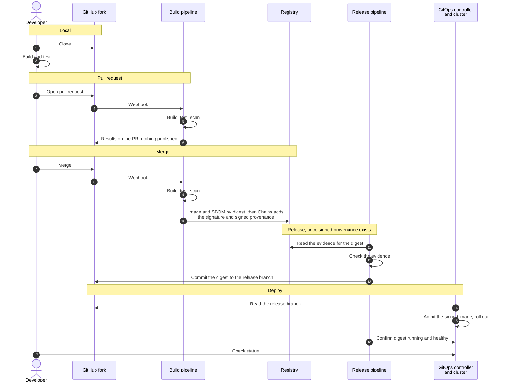
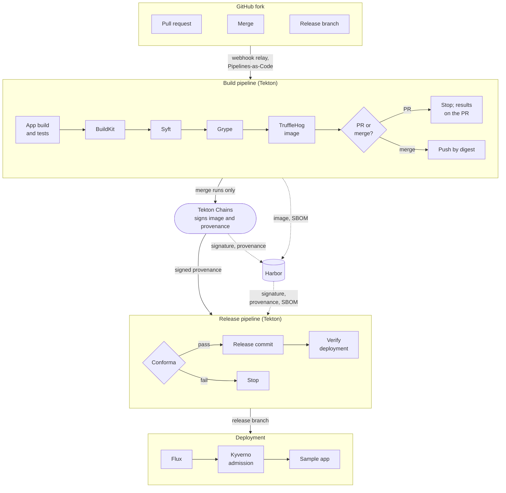

# Design: Executable Golden Path MVP for Kubernetes

This is the design for a small, runnable golden path: a developer merges a change, and the
platform builds it, checks it, releases it and deploys it to a local Kubernetes cluster. It
is the design step of
[issue #8](https://github.com/cdfoundation/Platform-Engineering/issues/8), written for
review before any code exists.

The example makes one slice of the
[open source SSDF reference architecture](../reference-architectures/open-source-ssdf-cicd.md)
executable. It uses the same tools, with one swap that page already lists: Flux CD in place
of Argo CD. Every step is defined by what it reads and writes, so each tool can be replaced
on its own.

## Developer workflow

| Stage | What happens | Stops when |
| --- | --- | --- |
| Local | The developer clones the repository and builds and tests the application with its own commands. | — |
| Pull request | CI builds and tests the change, builds the image, scans it for vulnerabilities and secrets, and reports on the PR. Nothing is pushed or deployed. | A build, test or scan fails |
| Merge | CI builds and scans the image, pushes it by digest, and each scan result is recorded against that digest in signed build provenance. | A build, test or scan fails |
| Release | A platform pipeline checks the signed evidence for that exact digest and, if it passes, commits the digest to the branch the GitOps controller reads. | Evidence is missing, invalid, for another digest, or records a failed check |
| Deploy | The GitOps controller rolls the digest out. The cluster admits only images the pipeline signed. A last step confirms the running pods use that digest and are healthy. | Image unsigned or referenced by tag, rollout fails, or app unhealthy |

### Developer and platform responsibilities

| | Developer | Platform |
| --- | --- | --- |
| Application source, Dockerfile, Kustomize manifests | Owns | Checks them in CI |
| Pipeline definitions | Supplies parameters, such as build and test commands | Owns; the app repo references them by digest |
| Release policy and admission policy | Reads the result | Owns |
| Image digest in the release branch | Never edits it | The release pipeline is the only writer |
| Signing key, release credential | No access | Held in platform namespaces |
| Deployment status | Reads it with the `flux` CLI | The GitOps controller reports it |

## Architecture

Everything runs in one kind cluster on the laptop except the developer's GitHub fork and a
webhook relay that forwards GitHub's events into the cluster.

The release pipeline writes its commit to the release branch on GitHub, and Flux reads that
branch with read-only access. Nothing else deploys to the application's namespace.

## Component choices

The second column is the issue's starting list. The last column is the Cybersecurity SIG
task the tool is listed under, as in the reference architecture; a dash means none.

| Capability | In the issue | For the MVP | Why | Swap | SIG task |
| --- | --- | --- | --- | --- | --- |
| Sample application | Minimal containerized HTTP service | The same, in Go | Standard library only; one static binary on a minimal base image | Any service with a Dockerfile | — |
| Local Kubernetes | kind | kind | Recreated with one command; teardown is deleting the cluster | minikube, k3d | — |
| Git host | — | The developer's GitHub fork | Most developers already have one; no Git server to run | An in-cluster Git server, which needs no relay | — |
| Trigger | — | Pipelines-as-Code, through a webhook relay (gosmee) | Starts a run for the exact commit and reports on the PR; the relay is how its docs reach a local cluster | A self-hosted Actions runner, which needs no relay | [1.1 PO.3.1–PO.3.3](https://cybersecurity.cd.foundation/docs/ssdf/phase-1/ssdf-po/) |
| CI | GitHub Actions | Tekton | GitHub-hosted runners can't reach a registry inside kind; Tekton runs in the cluster and is a CD Foundation project | GitHub Actions on a self-hosted runner in the cluster | — |
| Image build | BuildKit | BuildKit | Builds an ordinary Dockerfile unchanged | Buildah | [2.3 PW.6.1–PW.6.2](https://cybersecurity.cd.foundation/docs/ssdf/phase-2/ssdf-pw/) |
| SBOM | — | Syft | One inventory of the image, for the scan and for later slices | Trivy | [2.3 PW.6.1–PW.6.2](https://cybersecurity.cd.foundation/docs/ssdf/phase-2/ssdf-pw/) |
| Vulnerability scan | Trivy | Grype | Same role; the reference architecture's choice, with Trivy as its alternative | Trivy | [2.1 PO.4.1–PO.4.2](https://cybersecurity.cd.foundation/docs/ssdf/phase-2/ssdf-po/) |
| Image secret scan | — | TruffleHog | A secret can arrive in a dependency or base layer without being in the repository | Trivy | [2.3 PW.4.1–PW.4.4](https://cybersecurity.cd.foundation/docs/ssdf/phase-2/ssdf-pw/) |
| Registry | OCI-compatible registry | Harbor | Keeps the image, signature, provenance and SBOM together by digest | Any OCI registry that stores attached artifacts | [2.2 PS.3.1–PS.3.2](https://cybersecurity.cd.foundation/docs/ssdf/phase-2/ssdf-ps/) |
| Signing and provenance | Optionally Cosign | Tekton Chains | Signs outside the build steps, so a build can't sign its own result | Cosign from a platform-owned job | [2.2 PS.1.1](https://cybersecurity.cd.foundation/docs/ssdf/phase-2/ssdf-ps/) |
| Release gate | — | Conforma, with a small policy | One decision on signed evidence: valid signature and provenance, built by the platform's pipeline, both scans passed for this digest, SBOM present | Cosign policy mode; Conftest | [2.1 PO.1.1–PO.1.2](https://cybersecurity.cd.foundation/docs/ssdf/phase-2/ssdf-po/) |
| Desired state in Git | The developer updates it | The release pipeline commits the approved digest to a release branch | The developer's part ends at the merge, and a digest can't reach the cluster without passing the gate | — | — |
| GitOps | Flux or Argo CD | Flux CD | Git is the only way to change what runs, and its default install is small, with no UI or sign-in component to secure | Argo CD, the reference architecture's choice | [2.1 PO.2.1–PO.2.3](https://cybersecurity.cd.foundation/docs/ssdf/phase-2/ssdf-po/) |
| Packaging | Kustomize | Kustomize | The release commit sets the image digest in the overlay | Helm | — |
| Admission | — | Kyverno | Runs only images the pipeline signed, referenced by digest and applied by the GitOps controller | Sigstore Policy Controller | [2.1 PO.5.1–PO.5.2](https://cybersecurity.cd.foundation/docs/ssdf/phase-2/ssdf-po/), [2.2 PS.3.1–PS.3.2](https://cybersecurity.cd.foundation/docs/ssdf/phase-2/ssdf-ps/) |

## Local setup and teardown

- **Prerequisites:** a Docker-compatible container runtime, kind, kubectl, git, and a
  GitHub account for the fork.
- **Setup:** fork the repository, create two credentials for it (a token so the pipeline can
  report on pull requests, and a deploy key so the release pipeline can push the release
  branch), add a webhook that points at the relay, then run the bootstrap command. It
  creates the cluster and installs Flux, which installs everything else from pinned versions
  in Git.
- **Outside the laptop:** GitHub, and the webhook relay. Events pass through a public relay
  meant for local development only; Pipelines-as-Code still checks each one against the
  webhook secret.
- **Downloaded:** container images, pinned manifests and charts, and vulnerability data.
- **Teardown:** delete the cluster, then revoke the two credentials and remove the webhook
  on GitHub.

## Assumptions and limitations

- One cluster stands in for build, release and production, separated by namespaces. That
  shows the flow; it isn't production isolation.
- In a personal fork the developer also administers the repository. The split between
  developer and platform is shown by which credential can push the release branch, not
  enforced against the repository owner.
- Pipeline pods, Kyverno and the node's container runtime all have to reach the in-cluster
  registry and trust it. Every later step depends on that, so it is the first thing to prove
  in implementation.
- Conforma's ready-made rules mostly target Konflux's pipelines, so the example needs a
  small release policy of its own.
- Signing uses a key held in the cluster. Keyless signing and a transparency log are out, as
  in the reference architecture.
- A newly published vulnerability in the base image or a dependency can fail a run that
  passed the day before.
- Laptop resource needs are unknown until the first working run.
