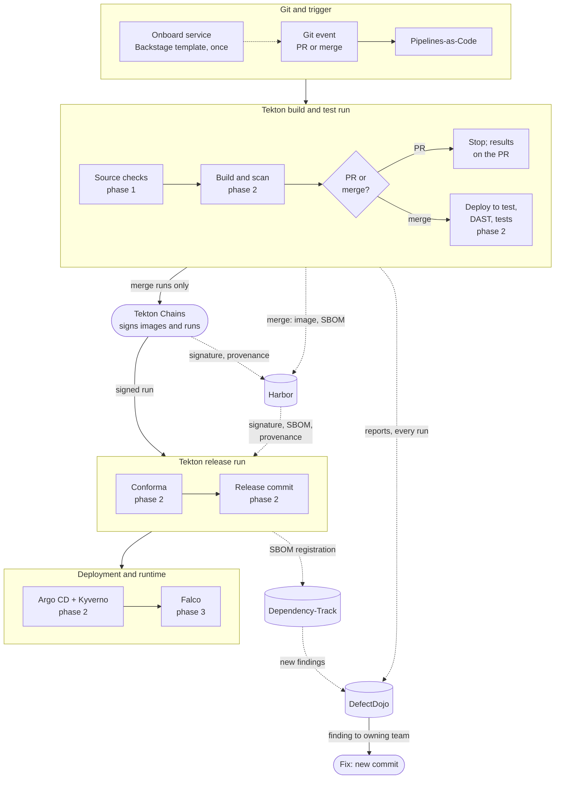
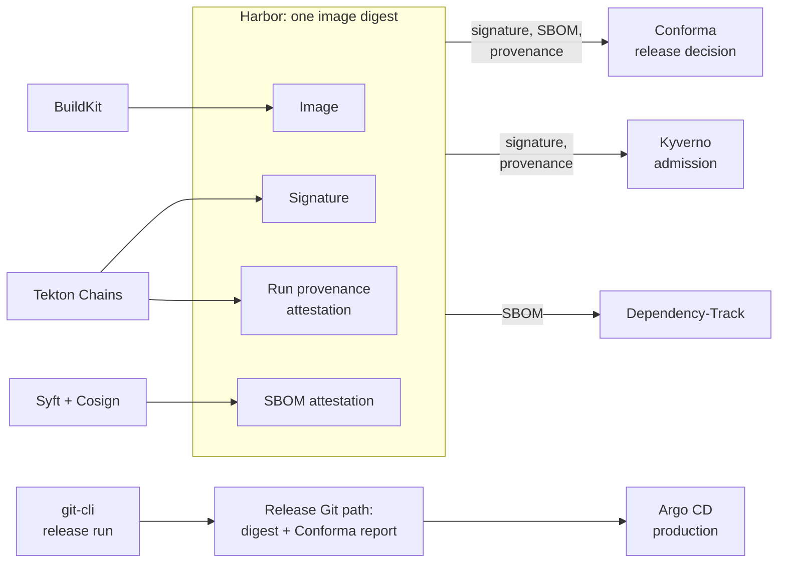
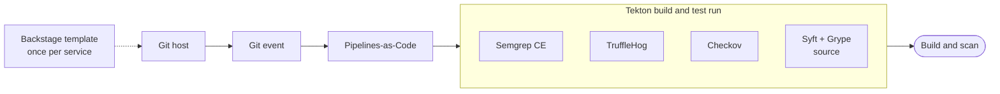
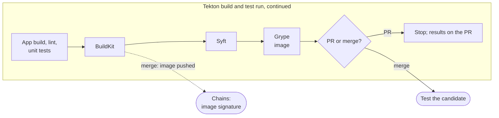
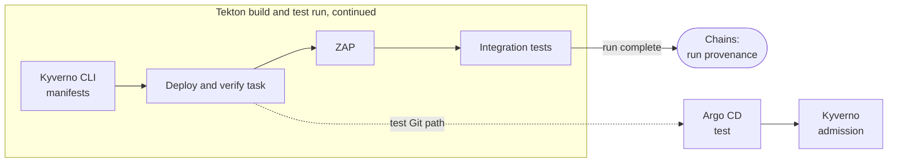
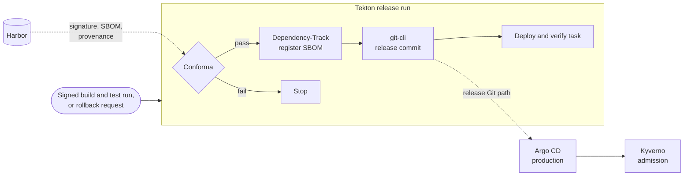
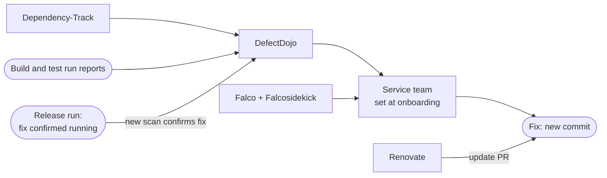

# Open Source CI/CD Reference Architecture for SSDF

This reference architecture connects open source tools into a CI/CD workflow aligned with
the [Cybersecurity SIG's guidance](https://cybersecurity.cd.foundation/docs/). It follows one
container image from commit to production, and back to the team that owns it when a new
vulnerability is found. It takes its approach from NIST's
[NCCoE DevSecOps](https://pages.nist.gov/nccoe-devsecops/) example implementations, but every
component here is open source.

It's written for platform engineers designing or extending a shared delivery pipeline. The
first diagram shows what runs where; the second shows the evidence that travels with the
image, which every later gate decides on. The sections after them follow the SIG's three
phases. Each table lists steps in the order they run: the tool, what it does and why, what
stops progression, the SIG task it aligns to, and a SIG-listed alternative.

Scope: containerized services on Kubernetes, from onboarding a service to remediating a
finding. Out of scope: design-time practices such as threat modeling, cluster provisioning,
Git host choice, language-specific tooling, and malware scanning (no SIG-listed tool).

## End-to-end delivery architecture

Pull requests run source checks and build and scan, then stop. Merges, which have passed
the team's review, continue with the same image digest through test, release and
deployment. Nothing is rebuilt after testing.

## Evidence on the image

Every gate after the build decides on evidence attached to the image digest in Harbor, or on
the release commit that pins that digest. Nothing is keyed by tag or by pipeline run, so
evidence can't be transplanted to another image, and the run can be pruned without losing
the record.

| Evidence | Written by | Attached as | Read by | SIG task |
| --- | --- | --- | --- | --- |
| Image | BuildKit, merge runs only | Pushed by digest; tags immutable | Argo CD, Kyverno | [2.2 PS.3.1](https://cybersecurity.cd.foundation/docs/phase-2/ssdf/ssdf-ps/) |
| Image signature | Chains, when the build task finishes | Cosign signature on the digest | Conforma, Kyverno | [2.2 PS.1.1](https://cybersecurity.cd.foundation/docs/phase-2/ssdf/ssdf-ps/) |
| SBOM attestation | Syft, signed by Cosign in the run | In-toto attestation, CycloneDX | Conforma, Dependency-Track | [2.2 PS.2.1](https://cybersecurity.cd.foundation/docs/phase-2/ssdf/ssdf-ps/) |
| Run provenance | Chains, when the run finishes | SLSA provenance attestation: commit, pipeline definition, each check's result | Conforma, Kyverno (presence) | [2.2 PS.1.1](https://cybersecurity.cd.foundation/docs/phase-2/ssdf/ssdf-ps/) |
| Scan reports | Every check, every run, failed runs included | Not on the image: sent to DefectDojo with the commit and digest (integration, retried) | DefectDojo | [2.1 PO.4.1–PO.4.2](https://cybersecurity.cd.foundation/docs/phase-2/ssdf/ssdf-po/) |
| Release approval | git-cli in the release run | Commit on the release Git path pinning the digest, with Conforma's report | Argo CD (production) | — |

## Phase 1: Code and Prebuild

Validate the source revision before its image is built.

| Tool | What it does here, and why | Blocks when | SIG task | SIG-listed alternative |
| --- | --- | --- | --- | --- |
| Backstage Software Templates | Once per service, creates what later steps assume exists: the repo with its pipeline definition, Argo CD applications for the test and release paths, a namespace labelled with the owning team, a DefectDojo product owned by that team, a Dependency-Track project, and the catalog entry. Any template system that creates the same set can replace it; not needed at runtime | — | [1.1 PO.3.1](https://cybersecurity.cd.foundation/docs/phase-1/ssdf/ssdf-po/) | Konflux (factory; brings its own pipeline and release model) |
| Git host (any) | Protected default branch, required review before merge, signed commits. The merge is the team's approval of the change; the pipeline doesn't re-approve it | Unreviewed or unsigned change: no merge | [1.2 PS.1.1](https://cybersecurity.cd.foundation/docs/phase-1/ssdf/ssdf-ps/), [1.1 PO.5.1](https://cybersecurity.cd.foundation/docs/phase-1/ssdf/ssdf-po/) | — |
| Pipelines-as-Code | Starts a Tekton build and test run for each PR or merge at its exact commit, using the default branch's pipeline definition. PRs from forks run only after a maintainer's `/ok-to-test`. Posts status and report links to the commit | Unsigned webhook, or repo or event not allowed: no run | [1.1 PO.3.2](https://cybersecurity.cd.foundation/docs/phase-1/ssdf/ssdf-po/) | — |
| Semgrep CE | Static analysis with open source rules. Which rule source is still unresolved: Semgrep's maintained rule set isn't open source | Finding above the team's criteria | [1.3 PW.7.2](https://cybersecurity.cd.foundation/docs/phase-1/ssdf/ssdf-pw/) | Bandit (Python only) |
| TruffleHog | Scans the commit history for secrets, with live verification off | Any unresolved secret | [1.3 PW.8.2](https://cybersecurity.cd.foundation/docs/phase-1/ssdf/ssdf-pw/) | Gitleaks |
| Checkov | Scans the Dockerfile, Kubernetes manifests, Helm or Kustomize sources and any Terraform in the repo for misconfigurations | Any failed check | [1.3 PW.2.1](https://cybersecurity.cd.foundation/docs/phase-1/ssdf/ssdf-pw/) | KICS |
| Syft + Grype | Inventories source dependencies and checks them for known vulnerabilities, so developers see problems before the build | Vulnerability above the team's criteria | [1.3 PW.6.1–PW.6.2](https://cybersecurity.cd.foundation/docs/phase-1/ssdf/ssdf-pw/) | Trivy (does both; SIG lists it under PW.2.1) |

## Phase 2: Build and Deploy

Build and test the image, evaluate the release evidence, and deploy the approved digest.

### Build and scan

Still inside the build and test run. Each subsection of this phase ends with the evidence
Chains attaches to the image.

| Tool | What it does here, and why | Blocks when | SIG task | SIG-listed alternative |
| --- | --- | --- | --- | --- |
| App build, lint and unit tests | Tekton runs the application's own build, lint and unit-test commands, in a pipeline task or the Dockerfile's build stage | Any command fails | — | — |
| BuildKit † | Builds the image from a multistage Dockerfile with a digest-pinned base image, in a pod created for this run with no shared cache. Dependencies are fetched first (Hermeto), so the build step itself needs no network. PR runs keep the image as a local file; merges push it to Harbor by digest | Build fails | [2.3 PW.6.1–PW.6.2](https://cybersecurity.cd.foundation/docs/phase-2/ssdf/ssdf-pw/) | apko (builds from a package list, no Dockerfile) |
| Syft | Generates the finished image's CycloneDX SBOM. On merges, Cosign signs it as an attestation on the image (`cosign attest`) | — | [2.3 PW.6.1–PW.6.2](https://cybersecurity.cd.foundation/docs/phase-2/ssdf/ssdf-pw/); Cosign: [2.2 PS.2.1](https://cybersecurity.cd.foundation/docs/phase-2/ssdf/ssdf-ps/) | Trivy (also scans) |
| Grype | Checks the image SBOM for known vulnerabilities. Its result names the digest it checked | Vulnerability above the team's criteria | [2.1 PO.4.1–PO.4.2](https://cybersecurity.cd.foundation/docs/phase-2/ssdf/ssdf-po/) | Trivy |
| Chains: image signature | Signs each pushed image as soon as its build task finishes, with a key only Chains can read. The signature sits next to the image in Harbor | Signing unavailable: Kyverno won't admit the image | [2.2 PS.1.1](https://cybersecurity.cd.foundation/docs/phase-2/ssdf/ssdf-ps/) | Cosign (explicit signing step); keyless signing with the run's own identity (Fulcio) |
| Harbor | Stores the image with its SBOM, signature and provenance, all by digest. Tags are immutable and retention never removes a released digest. The build and Chains push with separate robot accounts | Push from any other account | [2.2 PS.3.1](https://cybersecurity.cd.foundation/docs/phase-2/ssdf/ssdf-ps/) | — |

† BuildKit isn't listed by the SIG for this task. It's included as the most widely used
Dockerfile builder (Docker's default).

### Test the candidate

Merges only, still inside the build and test run.

| Tool | What it does here, and why | Blocks when | SIG task | SIG-listed alternative |
| --- | --- | --- | --- | --- |
| Kyverno CLI | Checks the rendered deployment manifests against the same policies the cluster enforces, before anything deploys | Any violation | [2.3 PW.9.2](https://cybersecurity.cd.foundation/docs/phase-2/ssdf/ssdf-pw/) | Open Policy Agent (Conftest) |
| Deploy and verify task | Tekton catalog tasks commit the digest to the test Git path, have Argo CD sync into a namespace created for this run and wait for health; a final step checks the running pods use that digest (integration). The namespace is deleted when the run ends | Sync fails, app unhealthy, or wrong digest running | — | — |
| Argo CD | Deploys the test Git path into the run's test namespace | Sync fails | [2.1 PO.5.1–PO.5.2](https://cybersecurity.cd.foundation/docs/phase-2/ssdf/ssdf-po/) | Flux CD (listed for PO.2) |
| Kyverno | Admits only images signed by Chains and referenced by digest | Unsigned, wrong signer, or tag reference | [2.2 PS.2.1](https://cybersecurity.cd.foundation/docs/phase-2/ssdf/ssdf-ps/) | Open Policy Agent (needs a separate signature-verification add-on) |
| ZAP | Scans the running candidate's HTTP and API endpoints, authenticated where the app needs it, driven by the app's OpenAPI definition when it has one | Alert above the team's criteria, or scan incomplete | [2.3 PW.8.2](https://cybersecurity.cd.foundation/docs/phase-2/ssdf/ssdf-pw/) | — |
| Integration tests | The team's tests against the running candidate | Failed test | — | — |
| Chains: run provenance | When the run ends, signs one SLSA provenance attestation for the whole run and attaches it to the image digest. It records the commit, the pipeline definition, and each check's result: every check emits a `TEST_OUTPUT` result naming the digest it checked and whether it passed (convention to validate) | Signing unavailable: nothing to release | [2.2 PS.1.1](https://cybersecurity.cd.foundation/docs/phase-2/ssdf/ssdf-ps/) | in-toto (attestation format; needs its own signing step) |

### Release and deploy

A separate Tekton release run starts once Chains has signed the build and test run
(integration). It runs in its own namespace under the only service account that can write
the release Git path. The signing key and the release Git credential are Kubernetes Secrets
in platform namespaces; application tasks never have access to them.

| Tool | What it does here, and why | Blocks when | SIG task | SIG-listed alternative |
| --- | --- | --- | --- | --- |
| Conforma | Fetches the signature and every attestation on the digest from Harbor and verifies them against the Chains key, then evaluates the versioned release policy on their contents: every required check present, passed and bound to this digest; source commit matches the Git event; SBOM present. A check that never ran fails like one that failed. Writes its report for the release record (SBOM format and provenance version to validate) | A required check missing, failed or skipped; results for another digest; signature or SBOM attestation missing | [2.1 PO.1.1](https://cybersecurity.cd.foundation/docs/phase-2/ssdf/ssdf-po/) | Open Policy Agent (Conftest; you write the signature and provenance rules) |
| Dependency-Track | Registers the image SBOM under the service and digest, and confirms processing finished | Registration not confirmed | [3.1 PO.3.1](https://cybersecurity.cd.foundation/docs/phase-3/ssdf/ssdf-po/) | Ortelius |
| git-cli (Tekton catalog) | Commits the approved digest and Conforma's report to the release Git path. This commit is the release approval and the release record | Another writer, or the Git head moved since Conforma's check | — | — |
| Deploy and verify task | Tekton catalog tasks have Argo CD sync production and wait for health; a final step checks the running pods use the released digest (integration) | Sync fails, app unhealthy, or wrong digest running | — | — |
| Argo CD | Syncs production from the release path only | Sync fails | [2.1 PO.2.1](https://cybersecurity.cd.foundation/docs/phase-2/ssdf/ssdf-po/) | Flux CD (listed for PO.2); Argo Rollouts (adds canary) |
| Kyverno | Admits only images signed by Chains, referenced by digest and carrying the run provenance attestation: the runtime backstop, so nothing reaches production except through the release path, whatever client applies it. The release policy itself stays in Conforma. Background scans re-check running workloads (to validate). Also enforces workload rules such as non-root and no privileged pods | Any violation | [2.1 PO.5.1–PO.5.2](https://cybersecurity.cd.foundation/docs/phase-2/ssdf/ssdf-po/), [2.2 PS.3.1](https://cybersecurity.cd.foundation/docs/phase-2/ssdf/ssdf-ps/) | Open Policy Agent (needs a separate signature-verification add-on) |

Conforma decides once whether this digest may be released. Kyverno decides every time
whether a pod may run. Build provenance (Chains) records how the image was built; the
release commit (git-cli) is the decision that it may deploy.

**Rollback** releases a previous release's digest and deployment configuration through the
same release checks.

## Phase 3: Post Deploy

Monitor deployed software and route findings through fix and reassessment.

| Tool | What it does here, and why | Blocks when | SIG task | SIG-listed alternative |
| --- | --- | --- | --- | --- |
| Dependency-Track | Re-checks every released SBOM as new vulnerabilities are published | No gate; raises findings | [3.4 RV.1.1](https://cybersecurity.cd.foundation/docs/phase-3/ssdf/ssdf-rv/) | Ortelius |
| DefectDojo | Holds every build and test run report, including failed runs, with the original files attached, plus Dependency-Track findings; deduplicates them and notifies the product's team, set at onboarding | Failed imports stay visible and are retried | [3.4 RV.2.1](https://cybersecurity.cd.foundation/docs/phase-3/ssdf/ssdf-rv/) | Ortelius |
| Renovate | Opens pull requests that update vulnerable or outdated dependencies, so the fix for a dependency finding is usually waiting as a PR. Merging it re-enters phase 1 | — | [2.4 RV.2.1–RV.2.2](https://cybersecurity.cd.foundation/docs/phase-2/ssdf/ssdf-rv/) | — |
| Falco + Falcosidekick | Detects suspicious runtime behavior and alerts the service's team, routed by the namespace label set at onboarding | No gate | [3.1 PO.5.1–PO.5.2](https://cybersecurity.cd.foundation/docs/phase-3/ssdf/ssdf-po/) | — |
| DefectDojo | Findings close after the fix is deployed and a new, complete scan confirms it, or a not-affected decision is recorded as OpenVEX, which Grype applies on the next scan (integration). History shows repeat issues | Failed or incomplete scans never close findings | [3.4 RV.2.1](https://cybersecurity.cd.foundation/docs/phase-3/ssdf/ssdf-rv/), [3.4 RV.3.1–RV.3.2](https://cybersecurity.cd.foundation/docs/phase-3/ssdf/ssdf-rv/); OpenVEX: [3.4 RV.1.1](https://cybersecurity.cd.foundation/docs/phase-3/ssdf/ssdf-rv/) | — |
