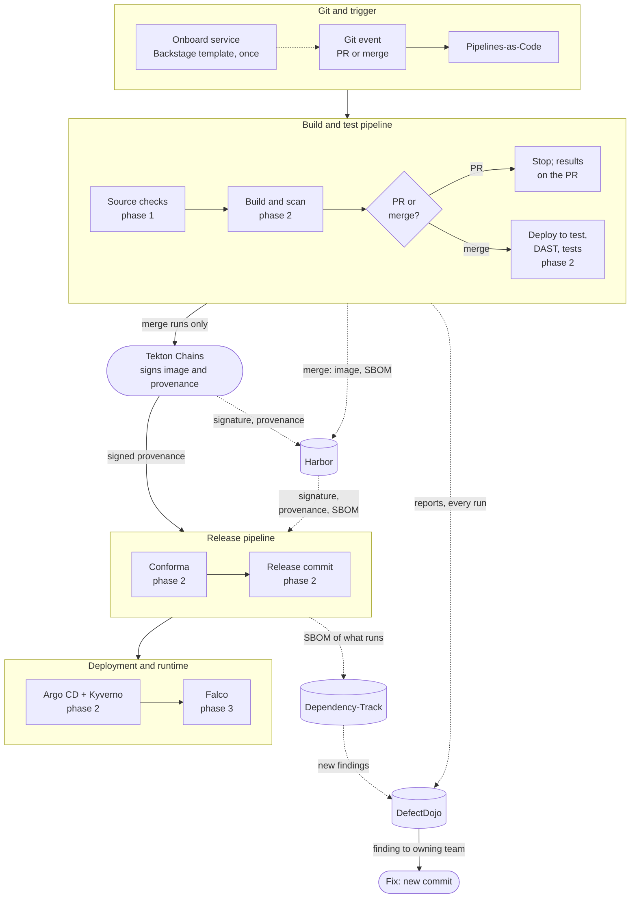
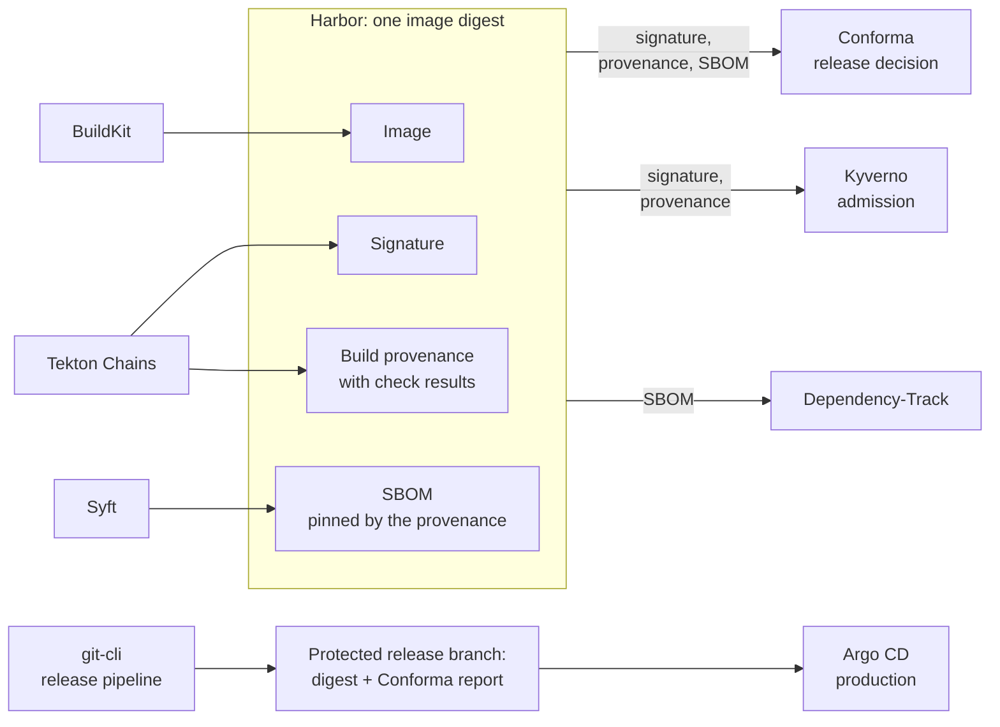
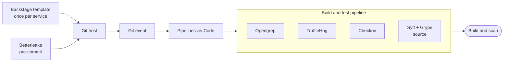
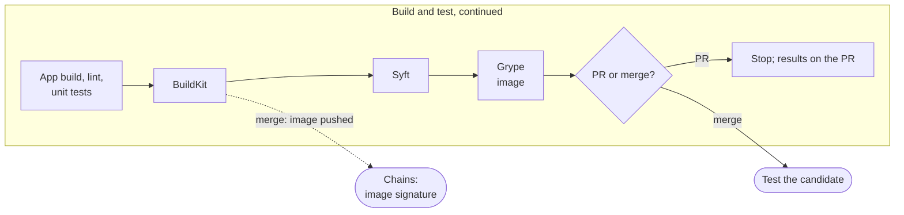
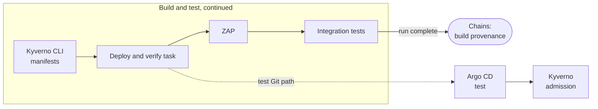
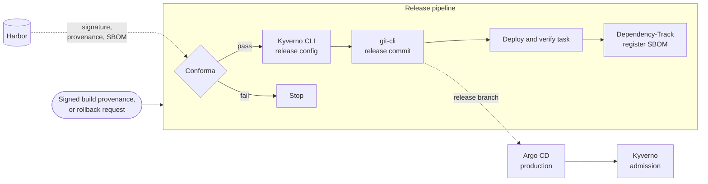
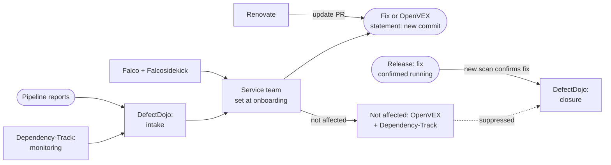

# Open Source CI/CD Reference Architecture for SSDF

This reference architecture connects open source tools into a CI/CD workflow aligned with
the [Cybersecurity SIG's guidance](https://cybersecurity.cd.foundation/docs/). It follows one
container image from commit to production, and back to the team that owns it when a new
vulnerability is found. It takes its approach from NIST's
[NCCoE DevSecOps](https://pages.nist.gov/nccoe-devsecops/) example implementations, but every
component here is open source.

It's written for platform engineers designing or extending a shared delivery pipeline. The
first diagram shows what runs where; the second shows the evidence that travels with the
image, which every later gate decides on. The sections after them follow the SIG's three
phases. Each table lists steps in the order they run: the tool, what it does and why, what
stops progression, the SIG task it aligns to, and a SIG-listed alternative.

Scope: containerized services on Kubernetes, from onboarding a service to remediating a
finding. Out of scope: design-time practices such as threat modeling, cluster provisioning
and hardening, identity providers and workload identity, a secrets manager, Git host choice,
language-specific tooling, and malware scanning.

## End-to-end delivery architecture

Pull requests run source checks and build and scan, then stop. Merges, which have passed
the team's review, continue with the same image digest through test, release and
deployment. Nothing is rebuilt after testing. Both pipelines are Tekton PipelineRuns here.

## Evidence on the image

Every gate after the build decides on evidence attached to the image digest in Harbor, or on
the release commit that pins that digest. Nothing is keyed by tag or by pipeline run, so
evidence can't be transplanted to another image, and the run can be pruned without losing
the record. The gates are defined by what they read, not by the tool that wrote it, following
SLSA v1.2 and CNCF TAG Security's supply chain best practices: provenance is generated and
signed outside the build steps, and each check's result is bound to the digest it checked.

| Evidence | Format | Written by | Signed by | Read by | SIG task |
| --- | --- | --- | --- | --- | --- |
| Image | OCI image, pushed by digest; tags immutable | BuildKit, merge runs only | — | Argo CD, Kyverno | [2.2 PS.3.1–PS.3.2](https://cybersecurity.cd.foundation/docs/phase-2/ssdf/ssdf-ps/) |
| Image signature | Cosign signature on the digest | Chains, when the build task finishes | Chains key | Conforma, Kyverno | [2.2 PS.1.1](https://cybersecurity.cd.foundation/docs/phase-2/ssdf/ssdf-ps/) |
| Build provenance | SLSA v1 (`https://slsa.dev/provenance/v1`) attestation on the digest: source commit, the platform pipeline definition by digest, the SBOM's digest | Chains, when the build and test run finishes | Chains key | Conforma, Kyverno | [2.2 PS.1.1](https://cybersecurity.cd.foundation/docs/phase-2/ssdf/ssdf-ps/) |
| Check results | One `TEST_OUTPUT` result per check inside the build provenance: the digest it checked and whether it passed | Each check in the platform pipeline | Chains key, as part of the provenance | Conforma | — |
| SBOM | CycloneDX document stored in Harbor by digest; the provenance pins it (`SBOM_BLOB_URL`) | Syft, merge runs only | Covered by the provenance signature | Conforma, Dependency-Track | [2.3 PW.6.1–PW.6.2](https://cybersecurity.cd.foundation/docs/phase-2/ssdf/ssdf-pw/) |
| Scan reports | Each tool's original output; not on the image | Every check, every run, failed runs included | — | DefectDojo | [2.1 PO.4.1–PO.4.2](https://cybersecurity.cd.foundation/docs/phase-2/ssdf/ssdf-po/) |
| Release approval | Commit on the protected release branch pinning the digest and its deployment configuration, with Conforma's report | git-cli in the release pipeline | — (only the release identity can push) | Argo CD (production) | — |

**If your CI isn't Tekton**, write the same evidence: the image signature, SLSA v1
provenance naming the platform pipeline by digest, the SBOM as a CycloneDX attestation, and
each check as an in-toto test-result attestation. Sign them with Cosign
([2.2 PS.1.1](https://cybersecurity.cd.foundation/docs/phase-2/ssdf/ssdf-ps/)) from a
platform-owned job that application steps can't change; Witness ‡ can generate the
provenance. Keep one writer per registry, and give Conforma a small policy package for the
new shapes (integration).

SLSA Build L3 is the design target for the Tekton reference implementation. Other CI
implementations must independently satisfy the applicable SLSA requirements.

‡ Witness hasn't reached 1.0, needs Cosign to attach its evidence to an image, and stores
attestations on an external service unless configured otherwise. The SIG lists it through
TestifySec under 2.2 PS.3.

## Phase 1: Code and Prebuild

Validate the source revision before its image is built.

| Tool | What it does here, and why | Blocks when | SIG task | SIG-listed alternative |
| --- | --- | --- | --- | --- |
| Backstage Software Templates | Once per service, creates what later steps assume exists: the repo with its build parameters, pre-commit config and a CODEOWNERS file naming the owning team, Argo CD applications for the test and release paths, a namespace labelled with the owning team, a DefectDojo product owned by that team, a Dependency-Track project, and the catalog entry that records the owner. Any template system that creates the same set can replace it; not needed at runtime | — | [1.1 PO.3.1–PO.3.3](https://cybersecurity.cd.foundation/docs/phase-1/ssdf/ssdf-po/), [3.1 PO.2.1–PO.2.3](https://cybersecurity.cd.foundation/docs/phase-3/ssdf/ssdf-po/) | — |
| Betterleaks † (pre-commit) | Checks each new commit on the developer's machine with the secret-scanning config the template adds, so a secret is caught before it's pushed. Uses Betterleaks' published hook, which scans the staged diff with `pipefail` and redacted output. It can be skipped, so the CI scan is the gate | Secret found: commit refused locally | [1.3 PW.8.1–PW.8.2](https://cybersecurity.cd.foundation/docs/phase-1/ssdf/ssdf-pw/) | Gitleaks (security fixes only) |
| Git host (any) | Protected default branch, review by code owners before merge, signed commits, MFA for every account. The merge is the team's approval of the change; the pipeline doesn't re-approve it. The release branch accepts pushes only from the release identity, with no force pushes | Unreviewed or unsigned change: no merge | [1.2 PS.1.1](https://cybersecurity.cd.foundation/docs/phase-1/ssdf/ssdf-ps/), [1.1 PO.5.1](https://cybersecurity.cd.foundation/docs/phase-1/ssdf/ssdf-po/), [1.1 PO.2.1](https://cybersecurity.cd.foundation/docs/phase-1/ssdf/ssdf-po/) | — |
| Pipelines-as-Code ‡ | Starts a build and test run for each PR or merge at its exact commit. The run uses the platform's pipeline definition, pinned by digest; the repo supplies only parameters such as its build commands, so a team can't change which checks run. PRs from forks run only after a maintainer's `/ok-to-test`. Posts status and report links to the commit | Unsigned webhook, or repo or event not allowed: no run | [1.1 PO.3.1–PO.3.3](https://cybersecurity.cd.foundation/docs/phase-1/ssdf/ssdf-po/) | — |
| Opengrep † | Static analysis with OSI-licensed community rules: Trail of Bits' (AGPL-3.0), and GitLab's without its Commons Clause and EE rules | Finding above the team's criteria | [1.3 PW.7.1–PW.7.2](https://cybersecurity.cd.foundation/docs/phase-1/ssdf/ssdf-pw/) | Semgrep CE (same engine and rule format; no cross-function taint); Bandit (Python only) |
| TruffleHog | Scans the run's local checkout for secrets with its built-in detectors, a second engine behind the pre-commit hook. No credential verification or update checks (`--no-verification --no-update --results=unverified`); a finding or a scan error fails the run (`--fail --fail-on-scan-errors`). Its JSON report imports through DefectDojo's TruffleHog parser | Any unresolved secret, or the scan errors | [1.3 PW.8.1–PW.8.2](https://cybersecurity.cd.foundation/docs/phase-1/ssdf/ssdf-pw/) | Betterleaks † (the hook's engine) |
| Checkov | Scans the Dockerfile, Kubernetes manifests, Helm or Kustomize sources and any Terraform in the repo for misconfigurations | Any failed check | [1.3 PW.2.1](https://cybersecurity.cd.foundation/docs/phase-1/ssdf/ssdf-pw/) | KICS |
| Syft + Grype | Inventories source dependencies and checks them for known vulnerabilities, applying the repo's OpenVEX statements, so developers see problems before the build | Vulnerability above the team's criteria | [1.3 PW.6.1–PW.6.2](https://cybersecurity.cd.foundation/docs/phase-1/ssdf/ssdf-pw/) | Trivy (does both; SIG lists it under PW.2.1) |

† Not in the SIG's list. The SIG lists Semgrep, but its maintained rules aren't open source
and its community edition tracks tainted data only within one function; Opengrep, an
LGPL-2.1 fork of the engine, also tracks it across functions in a file. The SIG lists
Gitleaks, which now receives security fixes only; Betterleaks is its actively maintained
successor from the same authors. Betterleaks 1.x writes a bare JSON array with Gitleaks'
field names, so a CI run can import through DefectDojo's Gitleaks parser; 2.x, still a
release candidate, switches to an object envelope and snake_case fields and needs its own
parser, so pin 1.x for now
([report changes](https://github.com/betterleaks/betterleaks/blob/main/docs/v2_migration.md#report-changes)).

‡ Pipelines-as-Code hasn't reached 1.0 and is maintained mainly by Red Hat.

## Phase 2: Build and Deploy

Build and test the image, evaluate the release evidence, and deploy the approved digest.

### Build and scan

Still inside the build and test run. Each subsection of this phase ends with the evidence
Chains attaches to the image.

| Tool | What it does here, and why | Blocks when | SIG task | SIG-listed alternative |
| --- | --- | --- | --- | --- |
| App build, lint and unit tests | The platform pipeline runs the application's own build, lint and unit-test commands, passed as parameters, in a pipeline task or the Dockerfile's build stage | Any command fails | — | — |
| BuildKit † | Builds the image from the repo's multistage Dockerfile with a digest-pinned base image, in a pod created for this run with no shared cache. Its own provenance and SBOM attestations are turned off, so Chains' are the only ones on the digest. PR runs keep the image as a local file; merges push it to Harbor by digest | Build fails | [2.3 PW.6.1–PW.6.2](https://cybersecurity.cd.foundation/docs/phase-2/ssdf/ssdf-pw/) | Buildah † with Hermeto (hermetic; needs Dockerfile changes); apko (builds from a package list, no Dockerfile) |
| Syft | Generates the finished image's CycloneDX SBOM. On merges, stores it in Harbor by digest and records that reference as its `SBOM_BLOB_URL` result, so the signed provenance pins it | — | [2.3 PW.6.1–PW.6.2](https://cybersecurity.cd.foundation/docs/phase-2/ssdf/ssdf-pw/) | Trivy (also scans) |
| Grype | Checks the image SBOM for known vulnerabilities, applying the repo's OpenVEX statements. Its result names the digest it checked | Vulnerability above the team's criteria | [2.1 PO.4.1–PO.4.2](https://cybersecurity.cd.foundation/docs/phase-2/ssdf/ssdf-po/) | Trivy |
| Chains ‡: image signature | Signs each pushed image as soon as its build task finishes, with a key only Chains can read. The signature sits next to the image in Harbor | Signing unavailable: Kyverno won't admit the image | [2.2 PS.1.1](https://cybersecurity.cd.foundation/docs/phase-2/ssdf/ssdf-ps/) | Cosign from a platform-owned job (any CI); keyless signing with the run's own identity (Fulcio) |
| Harbor | Stores the image with its signature, provenance and SBOM, all by digest. Tags are immutable and retention never removes a released digest or its evidence. The build and Chains push with separate robot accounts | Push from any other account | [2.2 PS.3.1–PS.3.2](https://cybersecurity.cd.foundation/docs/phase-2/ssdf/ssdf-ps/) | — |

† Not in the SIG's list. The SIG lists reproducible or hermetic build systems (Nix, Bazel,
apko, Hermeto) but no image builder. BuildKit is the most widely used Dockerfile builder and
builds existing Dockerfiles unchanged; the build is neither hermetic nor reproducible.
Hermeto prefetches dependencies so the build can run offline, but it's tested only with
Buildah and Podman, and the Dockerfile's dependency steps must use what it fetched.

‡ Chains hasn't reached 1.0 and is maintained mainly by Red Hat, under Tekton, a CNCF
incubating project.

### Test the candidate

Merges only, still inside the build and test run.

| Tool | What it does here, and why | Blocks when | SIG task | SIG-listed alternative |
| --- | --- | --- | --- | --- |
| Kyverno CLI | Checks the rendered deployment manifests against the same policies the cluster enforces, before anything deploys | Any violation | [2.3 PW.9.1–PW.9.2](https://cybersecurity.cd.foundation/docs/phase-2/ssdf/ssdf-pw/) | Open Policy Agent (Conftest) |
| Deploy and verify task | Tekton catalog tasks commit the digest to the test Git path, have Argo CD sync into a namespace created for this run and wait for health; a final step checks the running pods use that digest (integration). The namespace is deleted when the run ends | Sync fails, app unhealthy, or wrong digest running | — | — |
| Argo CD | Deploys the test Git path into the run's test namespace | Sync fails | [2.1 PO.2.1–PO.2.3](https://cybersecurity.cd.foundation/docs/phase-2/ssdf/ssdf-po/) | Flux CD |
| Kyverno | Admits only images signed by Chains and referenced by digest | Unsigned, wrong signer, or tag reference | [2.2 PS.2.1](https://cybersecurity.cd.foundation/docs/phase-2/ssdf/ssdf-ps/) | Sigstore Policy Controller; OPA Gatekeeper with Ratify |
| ZAP | Scans the running candidate's HTTP and API endpoints at a stable hostname, authenticated where the app needs it, driven by the app's OpenAPI definition when it has one | Alert above the team's criteria, or scan incomplete | [2.3 PW.8.1–PW.8.2](https://cybersecurity.cd.foundation/docs/phase-2/ssdf/ssdf-pw/) | Wapiti (SIG lists it in phase 3 only) |
| Integration tests | The team's tests against the running candidate | Failed test | — | — |
| Chains ‡: build provenance | When the run ends, signs one SLSA v1 provenance attestation for the whole run (predicate type `https://slsa.dev/provenance/v1`; set Chains' `artifacts.pipelinerun.format` to `slsa/v2alpha3`, a Chains format name, not a SLSA version) and attaches it to the image digest. It records the commit, the platform pipeline definition by digest, the SBOM's digest, and each check's `TEST_OUTPUT` result naming the digest it checked and whether it passed | Signing unavailable: nothing to release | [2.2 PS.1.1](https://cybersecurity.cd.foundation/docs/phase-2/ssdf/ssdf-ps/) | Cosign from a platform-owned job (any CI), with Witness ‡ generating the provenance |

### Release and deploy

The release pipeline starts once signed build provenance exists for the digest; in Tekton,
when Chains marks the build and test run signed (integration). It runs from a platform-owned
pipeline definition pinned by digest, in its own namespace, under the only identity that can
push to the release branch. The signing key and the release
Git credential are Kubernetes Secrets in platform namespaces; application tasks never have
access to them.

| Tool | What it does here, and why | Blocks when | SIG task | SIG-listed alternative |
| --- | --- | --- | --- | --- |
| Conforma ‡ | Verifies the signature and build provenance against the Chains key, then applies the release policy, versioned in Git: the provenance names the pinned platform pipeline; the commit is on the protected default branch; every required check passed for this digest; the pinned SBOM exists. A check that never ran fails like one that failed. Writes its report for the release record | A required check missing, failed or skipped; results for another digest; wrong pipeline definition; signature, provenance or SBOM missing | [2.1 PO.1.1–PO.1.2](https://cybersecurity.cd.foundation/docs/phase-2/ssdf/ssdf-po/) | Cosign policy mode (`verify-attestation --policy`; you write the rules); Open Policy Agent (Conftest) |
| Kyverno CLI | Checks the deployment configuration about to be committed to the release branch against the same policies the cluster enforces | Any violation | [2.3 PW.9.1–PW.9.2](https://cybersecurity.cd.foundation/docs/phase-2/ssdf/ssdf-pw/) | Open Policy Agent (Conftest) |
| git-cli (Tekton catalog) | Commits the approved digest, its deployment configuration and Conforma's report to the protected release branch. This commit is the release approval and the release record | Another writer, or the branch moved since Conforma's check | — | — |
| Deploy and verify task | Tekton catalog tasks have Argo CD sync production and wait for health; a final step checks the running pods use the released digest (integration) | Sync fails, app unhealthy, or wrong digest running | — | — |
| Dependency-Track | Once the deployment is verified, uploads the SBOM the provenance pins to the service's rolling `production` version, records the digest, and confirms processing finished, so it always holds what is running | Registration not confirmed: retried | [3.1 PO.3.1–PO.3.3](https://cybersecurity.cd.foundation/docs/phase-3/ssdf/ssdf-po/) | Grype rescanning stored SBOMs ([3.4 RV.1.1–RV.1.3](https://cybersecurity.cd.foundation/docs/phase-3/ssdf/ssdf-rv/)) |
| Argo CD | The only deployer to production: syncs from the release branch with read-only repository access. Git controls who may promote; Argo CD doesn't verify the configuration cryptographically | Sync fails | [2.1 PO.2.1–PO.2.3](https://cybersecurity.cd.foundation/docs/phase-2/ssdf/ssdf-po/), [2.1 PO.5.1–PO.5.2](https://cybersecurity.cd.foundation/docs/phase-2/ssdf/ssdf-po/) | Flux CD; Argo Rollouts (adds canary). To verify the configuration too: Argo CD's GPG check of a signed release tag (adds a signing key) |
| Kyverno | Admits only images signed by Chains, referenced by digest, whose provenance names the platform builder and pipeline. In production, only Argo CD's service account may create or change workloads, so the release branch is the only way in. Also enforces workload rules such as non-root and no privileged pods, and re-checks running workloads in background scans | Any violation | [2.1 PO.5.1–PO.5.2](https://cybersecurity.cd.foundation/docs/phase-2/ssdf/ssdf-po/), [2.2 PS.3.1–PS.3.2](https://cybersecurity.cd.foundation/docs/phase-2/ssdf/ssdf-ps/) | Sigstore Policy Controller; OPA Gatekeeper with Ratify |

‡ Conforma is maintained mainly by Red Hat and hasn't reached 1.0. Teams that can't accept a
single-vendor governance dependency should evaluate Cosign's policy mode or Open Policy Agent
(Conftest) for this role.

Conforma decides once whether this digest may be released. Kyverno decides every time
whether a pod may run. Build provenance (Chains) records how the image was built; the
release commit on the protected branch is the decision that it may deploy.

**Rollback** releases a previous release's digest and deployment configuration through the
same release checks. After a key rotation, Kyverno keeps the previous Chains key listed so
released digests stay deployable.

## Phase 3: Post Deploy

Monitor deployed software and route findings through fix and reassessment.

| Tool | What it does here, and why | Blocks when | SIG task | SIG-listed alternative |
| --- | --- | --- | --- | --- |
| Dependency-Track: monitoring | Re-checks the running SBOM as new vulnerabilities are published, and pushes its open findings to the service's DefectDojo product on a schedule (built-in integration). Owners work dependency findings from here; Grype's pipeline results stay a record | No gate; raises findings | [3.4 RV.1.1–RV.1.3](https://cybersecurity.cd.foundation/docs/phase-3/ssdf/ssdf-rv/) | Grype rescanning stored SBOMs |
| DefectDojo: intake | Each service's product has three engagements: pull requests (a record only), the default branch (each merge run replaces the tool's results) and production (Dependency-Track's push). Every run's reports arrive with the original files, failed runs included; only a complete scan replaces earlier results, and a partial one is kept apart, marked incomplete (integration, retried). Notifies the team set at onboarding | Failed imports stay visible and are retried | [3.4 RV.2.1–RV.2.2](https://cybersecurity.cd.foundation/docs/phase-3/ssdf/ssdf-rv/) | — |
| Renovate ‡ | Opens pull requests that update outdated dependencies and, with `osvVulnerabilityAlerts`, one as soon as a fix exists for a newly published vulnerability, so the fix for a dependency finding is usually waiting as a PR. Merging it re-enters phase 1 | — | [2.4 RV.2.1–RV.2.2](https://cybersecurity.cd.foundation/docs/phase-2/ssdf/ssdf-rv/) | — |
| Falco + Falcosidekick † | Detects suspicious runtime behavior and alerts the service's team, routed by the namespace label set at onboarding | No gate | [3.1 PO.5.1–PO.5.2](https://cybersecurity.cd.foundation/docs/phase-3/ssdf/ssdf-po/) | — |
| Not affected: OpenVEX + Dependency-Track | The service team records the decision with its justification as an OpenVEX statement in the service repo, through a reviewed PR; Grype applies it in both its scans. Because Dependency-Track reads only CycloneDX VEX, the same decision is entered there as not affected and suppressed, which drops it from the DefectDojo push | — | [3.4 RV.2.1–RV.2.2](https://cybersecurity.cd.foundation/docs/phase-3/ssdf/ssdf-rv/); OpenVEX: [3.4 RV.1.1–RV.1.3](https://cybersecurity.cd.foundation/docs/phase-3/ssdf/ssdf-rv/) | — |
| DefectDojo: closure | A finding closes when a complete rescan no longer reports it: the fix is running, or the not-affected decision is recorded. Not-affected dependency findings show as mitigated; the justification stays in the repo's OpenVEX and in Dependency-Track. History shows repeat issues | Failed or incomplete scans never close findings | [3.4 RV.2.1–RV.2.2](https://cybersecurity.cd.foundation/docs/phase-3/ssdf/ssdf-rv/), [3.4 RV.3.1–RV.3.4](https://cybersecurity.cd.foundation/docs/phase-3/ssdf/ssdf-rv/) | — |

‡ The SIG lists Renovate for RV.2 in phases 1 and 2. It's here because it opens the fix for
findings raised after deployment; its vulnerability alerts cover direct dependencies only,
and Dependency-Track covers the rest.

† Falco is SIG-listed; Falcosidekick, its alert router from the same project, isn't.
